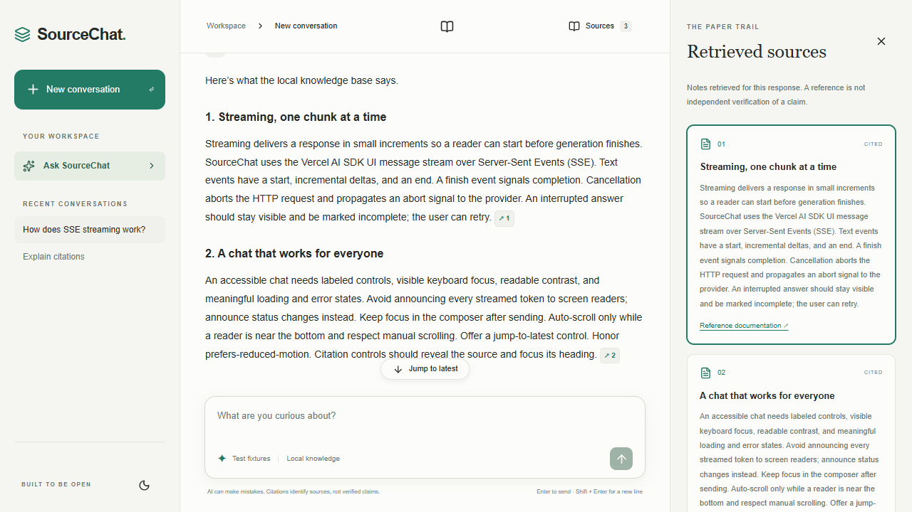

# SourceChat

A simple AI chat app built with Next.js, TypeScript, Tailwind CSS, and the Vercel AI SDK.

## Features

- Choose from available free OpenRouter models.
- Stream responses, stop generation, and retry requests.
- Read Markdown and highlighted code, and copy responses.
- Follow citations to notes in the local knowledge base.
- Save conversation history in your browser.
- Use light or dark mode on desktop and mobile.

## Setup

Requires Node.js 22.12 or newer and an [OpenRouter API key](https://openrouter.ai/settings/keys).

```bash
npm ci
cp .env.example .env.local
```

Add your key to `.env.local`:

```dotenv
OPENROUTER_API_KEY=your-key
OPENROUTER_MODEL=minimax/minimax-m3.1-flash:free
MOCK_AI=false
```

Start the app:

```bash
npm run dev
```

Open [localhost:3000](http://localhost:3000). Restart the server after changing environment variables. Keep your API key private; it is used only on the server.

On PowerShell, use `Copy-Item .env.example .env.local` instead of `cp`. Use `npm.cmd` if PowerShell blocks npm scripts.

## How it works

The `/api/chat` route validates messages, finds relevant local notes, and streams an answer through OpenRouter. Citation IDs are checked against those notes. Clicking a citation opens its source in the side panel.

The app does not search the web. Citations point to local notes and do not guarantee that an answer is correct. Free models may be unavailable or rate limited.

History stays in this browser, with up to 20 conversations and 40 saved messages per conversation. There are no accounts or database.

## Development

```bash
npm run format
npm run format:check
npm run typecheck
npm test
npx playwright install chromium
npm run test:e2e
npm run build
```

Install the recommended Prettier extension in VS Code to format files on save.

Tests use local fixtures and do not consume API credits. For offline development, set `MOCK_AI=true`.

## Preview


