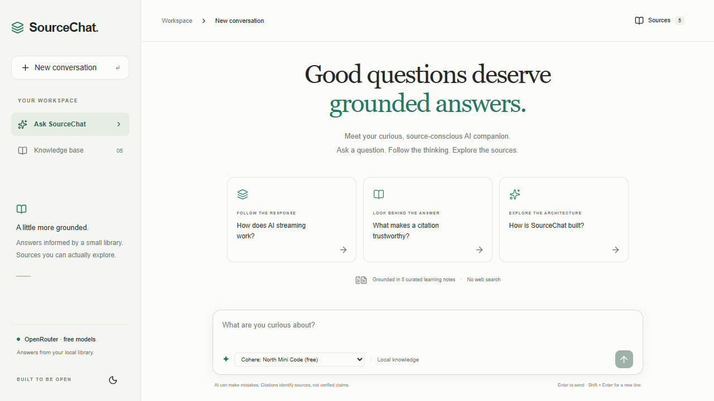
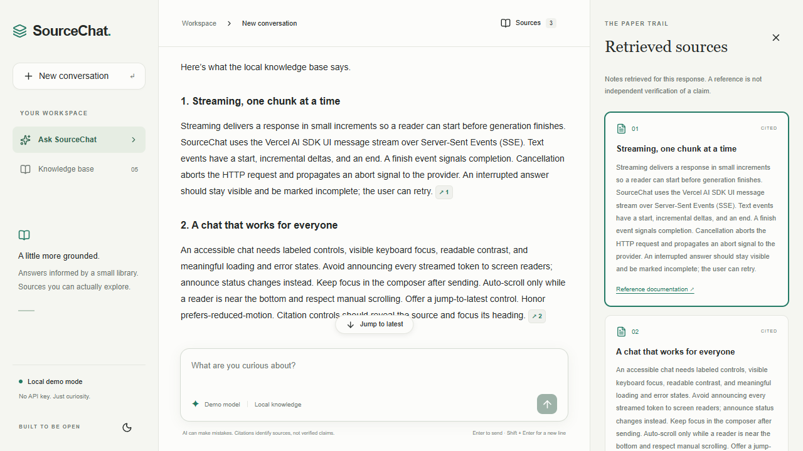

# SourceChat

**Good questions deserve grounded answers.**

A focused AI chat built to explore streaming, retrieval, and source citations. Uses available free OpenRouter models, with local fixtures reserved for automated testing. No database, authentication, or paid model is required.

## Quick start

Use Node.js 22.12+ (a current LTS release is recommended).

```bash
npm ci
cp .env.example .env.local
npm run dev
```

Add your OpenRouter API key to `.env.local`, then open [localhost:3000](http://localhost:3000). On Windows PowerShell, use `Copy-Item .env.example .env.local`; if script execution is disabled, use `npm.cmd` instead of `npm`.

Real AI mode is the default. Choose a free model in the composer and ask about streaming, citations, architecture, accessibility, or testing. There is no demo-model option. `MOCK_AI=true` explicitly enables local fixtures for tests or offline development; it makes no external requests.

## Real AI mode

Create an [OpenRouter API key](https://openrouter.ai/settings/keys), then set these **server-only** values in `.env.local`:

```dotenv
MOCK_AI=false
OPENROUTER_API_KEY=your-key
OPENROUTER_MODEL=minimax/minimax-m3.1-flash:free
```

Restart the development server after changing environment values. Never prefix the key with `NEXT_PUBLIC_` or commit `.env.local`.

The preferred model is [MiniMax M3.1 Flash (free)](https://openrouter.ai/minimax/minimax-m3.1-flash%3Afree), configured as `minimax/minimax-m3.1-flash:free`. The server loads the [OpenRouter model catalog](https://openrouter.ai/docs/api/api-reference/models/list-all-models-and-their-properties) and lists free text models in the composer. It accepts only free model IDs with zero listed prompt, completion, and request prices. The catalog is cached for up to five minutes and checked again on submission. If the preferred model is absent, the selector starts with the first available free model. Other IDs are rejected; there is no paid fallback. A catalog listing does not guarantee immediate capacity: free models can still be rate limited or unavailable. No web search is enabled. Only real mode sends the conversation and retrieved notes to OpenRouter.

SourceChat uses this model through `@openrouter/ai-sdk-provider` and Vercel AI SDK `streamText`. The standalone `@openrouter/sdk` example uses the same model endpoint; the application keeps the AI SDK transport for its streaming UI, cancellation, and citation filtering. The API key is always read from `OPENROUTER_API_KEY` on the server.

## Architecture

```text
src/
  app/
    page.tsx                 Server Component; passes public mode flag
    api/chat/route.ts        Validation, retrieval, streaming orchestration
  components/
    ui/button.tsx            shadcn/ui-style Button with Radix Slot and CVA
    chat/                    Client chat, markdown, message rendering
  lib/
    ai/                      Server-only provider, mock fixtures, message types
    knowledge/               Typed notes, deterministic retrieval, citation filter
    validation/              Zod text-only request schema
tests/                       Vitest unit, component and route tests
e2e/                         Playwright tests against forced mock mode
```

The UI uses React, strict TypeScript, Tailwind CSS, and a small shadcn/ui component foundation (`components.json` is included). The page stays a Server Component; interactive state lives in the chat Client Component. The API key is read only inside a module guarded by `server-only`.

### How streaming works

1. `useChat` sends text-only conversation history through `DefaultChatTransport` to `POST /api/chat`.
2. Zod rejects invalid roles, non-text input, empty prompts, excessive history, and oversized parts. The route also checks the body size.
3. The server retrieves up to three local documents and sends their trusted metadata in a typed `data-sources` event.
4. Real mode calls Vercel AI SDK `streamText` with the OpenRouter provider; mock mode incrementally emits deterministic local text without an external call.
5. Both branches use `createUIMessageStream` and `createUIMessageStreamResponse`, delivering text-start/delta/end and finish events over the SDK’s SSE protocol. The client uses the SDK parser rather than a handwritten SSE implementation.

Stop generation aborts the client request; its signal propagates to the provider and the mock delay loop. Partial text stays visible with an incomplete notice and retry control. Provider error events are surfaced rather than silently treated as completion. Errors are sanitized, rate limits get a useful message, and there are no automatic provider retries. A 55-second server timeout bounds generation. Retry regenerates the last answer. This app does not resume streams after a disconnect.

See the official [AI SDK stream protocol](https://ai-sdk.dev/docs/ai-sdk-ui/stream-protocol) and [OpenRouter integration](https://openrouter.ai/docs/guides/community/vercel-ai-sdk). The lockfile pins the actual installed versions; their TypeScript definitions are the compatibility check.

### How citations work

The knowledge base contains five original learning notes with stable IDs, titles, reference URLs or local references, content, and tags. A deterministic weighted keyword score ranks them. This is small-scale retrieval, without embeddings or a vector database.

The model receives the retrieved notes and instructions to use `[[document-id]]` citations. A server-side incremental filter accepts IDs only from that request’s retrieved set. It retains incomplete tokens across chunk boundaries and replaces unknown or malformed tokens with `(unverified reference)`.

The client turns known citation tokens into keyboard-accessible controls. Clicking one opens the sources panel and focuses the document heading. The panel distinguishes retrieved notes from cited notes and shows their full content. Reference URLs come only from the predefined documents. Model-authored links and images are not rendered as links or remote images, and raw HTML is disabled.

**A valid citation proves only that the ID refers to a retrieved document. It does not prove that the document supports a particular claim.** These are local learning notes, not live copies of external documentation. OpenRouter does not automatically provide search or trustworthy evidence.

## Interaction and accessibility

- Responsive chat workspace and sources panel; light/dark preference saved locally.
- Labeled composer, visible keyboard focus, citation focus handling, and status announcements without reading every token aloud.
- Enter sends; Shift + Enter inserts a line break. IME composition is respected.
- Auto-scroll follows the response while the reader is near the bottom. Manual scrolling reveals a jump-to-latest control.
- Markdown, code syntax highlighting, copy response, empty/loading/error states, stop, and manual retry.
- Reduced-motion preferences disable animation and transitions.

## Tests and checks

```bash
npm run typecheck
npm test
npx playwright install chromium
npm run test:e2e
npm run build
```

Vitest covers retrieval ordering and no-match behavior, citation chunk boundaries and invalid IDs, request validation, mock SSE, the real SDK/provider path with a mocked upstream endpoint, error sanitization, chat states, code highlighting, and copying. Playwright starts its own server on port 3100 with `MOCK_AI=true`, covering desktop and mobile submission, citations, focus, cancellation, interrupted streams, theme persistence, and retry. Tests do not consume API credits. Keep port 3100 free; existing servers are intentionally not reused.

To test a production build, run `npm run build`, then set `PLAYWRIGHT_PRODUCTION=1` before running the browser suite. Set `PLAYWRIGHT_CHANNEL=chrome` to use an existing Chrome installation instead of downloading Chromium. Set `CAPTURE_SCREENSHOTS=1` to refresh the documented browser captures. These flags are optional and are not needed for the default test commands.

Verified on October 19, 2026: strict type checking, 30 Vitest tests, and `next build`. The real model catalog returned 18 free text models; desktop and mobile browser checks verified selection, the outgoing model ID, and citation focus with generation intercepted locally. Live OpenRouter generation has not been tested with a real API key.

For a manual real-provider smoke test, enable real mode and ask “How does SSE streaming work?” Check that text appears progressively, a citation opens its local note, Stop halts generation, and Retry generates a replacement. Test invalid-key and quota errors separately. A real-provider smoke test requires your own key and is not established by mock tests.

## Example screenshots

Actual captures of the production app. The welcome screen uses the live model catalog; the cited conversation uses local test fixtures:





[Mobile model selector](docs/screenshots/mobile-models.png) · [Mobile citations](docs/screenshots/mobile-citations.png) · [Dark mode](docs/screenshots/chromium-dark.png) · [Mobile dark mode](docs/screenshots/mobile-dark.png)

## Known limitations and next steps

- Five curated notes and lexical matching are intentionally small. Follow-up retrieval uses the latest question only; it can miss context from earlier turns.
- Citations validate provenance IDs, not semantic support or factual correctness. Model-written URLs are suppressed in the UI, not used as evidence.
- Conversations are in memory and disappear on refresh. No persistence, accounts, database, or cross-tab sync.
- Forty-message history and bounded request sizes keep the learning project small; start a new conversation when the limit is reached.
- No production abuse protection or distributed rate limiting. A public real-key deployment needs hosting-level request controls before unrestricted exposure.
- The body length check runs after reading the request; configure an upstream body limit for hostile traffic.
- Free-model availability and responsiveness can change. Automated tests use mock data; real-service behavior needs manual verification.
- Accessibility uses native controls and focused tests; a full screen-reader audit remains future work.

Useful future improvements: contextual follow-up retrieval, chunk-level document indexing, an accessibility audit, and claim-to-excerpt evaluation. Keep the project focused on understanding the request → retrieval → streaming → citation pipeline.
